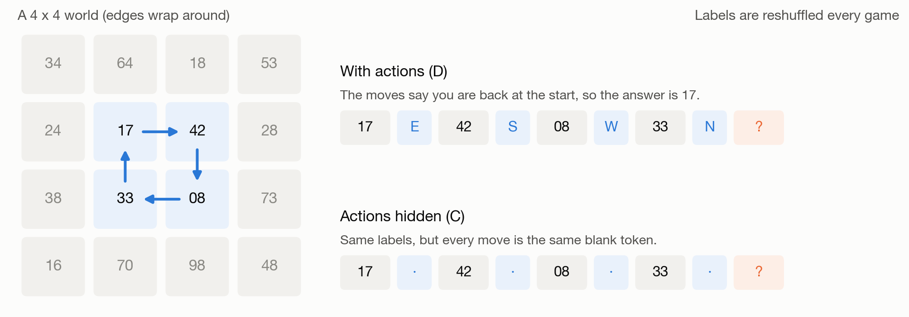
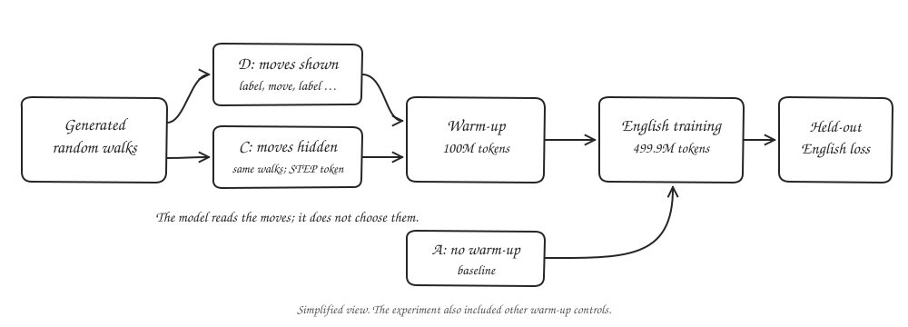
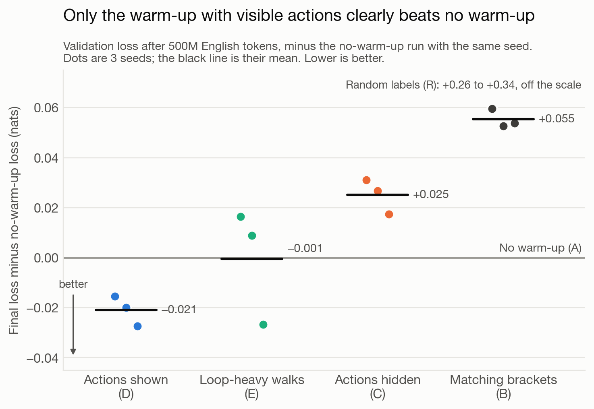
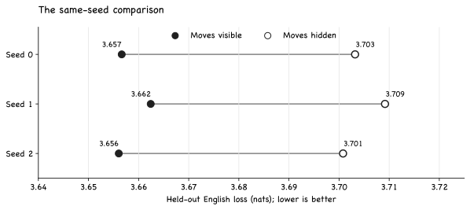
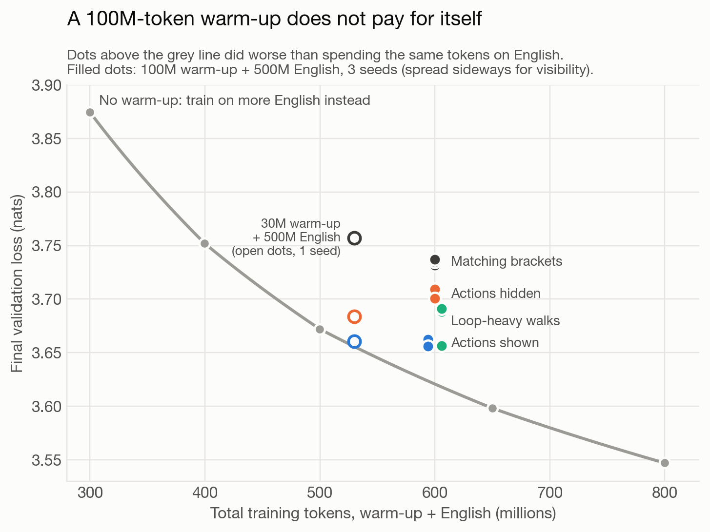
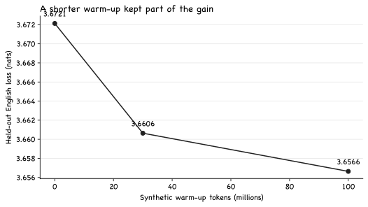
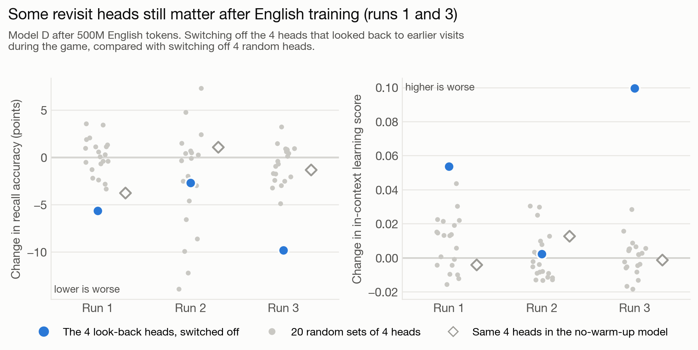

**TL;DR:** Can a cheap synthetic game prepare a language model to learn from less text? In this small experiment, seeing the consequences of moves improved held-out English prediction compared with both hiding the moves and skipping the game. But the 100-million-token warm-up cost more than the estimated English tokens it saved. A shorter warm-up came close to breaking even in one run. The puzzle is what kind of practice transfers, and whether it can pay for itself.

## Why train on a toy world?

A language model's training budget is spent predicting the next token. That single exercise has to support many later uses: following a conversation, tracking a change in a document, answering a question about a long passage, or writing code that uses a variable introduced earlier. These tasks differ, but each can require information from earlier in a sequence to remain useful after intervening events.

Suppose a model could practise one ingredient of that work before reading a large corpus. Synthetic examples are attractive because we can generate as many as we want and control their rules. The real question is not whether the extra practice lowers loss. More training can do that. It is whether the improvement is larger than the improvement from spending the same budget on text, including the cost of the synthetic stage. And if it helps, what property of the exercise made the difference?

Consider a sentence in which a person leaves a key in a room, walks away, and later returns. Answering where the key is requires keeping track of an object across a sequence of events. Predicting text also rewards sensitivity to such dependencies, although it does not require the model to solve each one in the way a person would. I wanted to know whether practice with a simpler kind of dependency could make subsequent language training more efficient.

The choice of movement was inspired partly by how animals learn. In a classic experiment, [Held and Hein](https://pubmed.ncbi.nlm.nih.gov/14050177/) gave paired kittens similar visual experience, but only one kitten in each pair moved itself. The kittens that moved developed visually guided behaviour that their passively carried partners did not. I find that distinction compelling. Acting does not just provide more pictures. It ties a change in the world to something the learner did.

There is also a connection to memory. The hippocampal formation is involved in both spatial navigation and remembering relationships. The [Tolman–Eichenbaum Machine](https://pubmed.ncbi.nlm.nih.gov/33181068/) is one attempt to model how relational structure can carry between experiences. People navigating an abstract conceptual space can also show a [grid-like neural signal](https://pubmed.ncbi.nlm.nih.gov/27313047/). Those findings do not say that a language model learns like a brain. They do make me wonder whether practising relationships in one setting can leave something useful for another.

Other work has tried giving language models a synthetic warm-up before natural language. [Hu and colleagues](https://arxiv.org/abs/2502.19249) used matching brackets and reported that their model reached a given loss with fewer tokens. [Lee and colleagues](https://arxiv.org/abs/2603.10055) explored cellular automata and reported faster convergence. I wanted to try a different kind of structure: a sequence of places connected by moves.

The analogy has a decisive limit: my model did **not** control a body or choose its actions. I generated random walks first, then trained the model on their written traces. This is a test of learning from action information, not a test of active exploration like the kitten experiment.

## Why movement, specifically?

A walk gives us a useful experimental contrast. The labels can be arbitrary, but the relation between them is not: a sequence of moves determines whether the walker returns to a previous square. The model cannot solve every return by learning that one particular label usually follows another, because the labels change between games. It has to use the current episode somehow.

That makes the game a controlled way to study a question that also arises in language: when does information from earlier in a sequence become relevant again? The resemblance is functional, not literal. English has syntax, facts, ambiguity, and social context. A grid has north, south, east, west, and the occasional existential crisis at the edge of a map that wraps around. Learning one does not amount to learning the other.

The experiment therefore has two possible payoffs. An effective warm-up could reduce the cost of reaching a given language loss. Even a warm-up that fails that economic test can help us identify which training experiences change later learning. Those are different claims, and I will keep their scorecards separate.

## The little world

*A simplified game. The actual grids range from 4 × 4 to 12 × 12, with labels drawn from 256 possibilities. Select any figure to view it at full size.*

Imagine walking around a grid whose edges wrap around. Each square has a label, and the labels change from one game to the next. A record might say: here is a label, take a step north, here is another label, take a step west, and so on.

For example, imagine starting on the square labelled `A`. Move north to `B`, then south. The next label is `A` again. The model does not need to know what `A` means; it needs to connect the return journey to a previous observation. A longer route can return without an immediate reversal, so memorising the last label alone is not enough for every revisit.

The model is trained to predict the labels, not the moves. A label at a square it has never visited cannot be guessed from the map. A label at a square it has seen before can be remembered, but the model has to keep track of where the moves have taken it. Going north then south, for example, brings it back to the same square.

My main control keeps the same walks and labels but replaces every move with the same `STEP` token. The model still sees a sequence of observations. It no longer gets to distinguish north from south.

## What I compared

*The model reads generated traces; it does not select the moves. After a synthetic warm-up, the models receive fresh token embeddings before English training.*

I trained a 51-million-parameter language model in two stages. The optional first stage used 100 million synthetic tokens. The second used the same 499.9 million tokens of FineWeb-Edu English in every run. I reinitialised the token embeddings between stages, while carrying the transformer blocks and final normalisation forward. That makes the test about what transfers beyond the particular synthetic vocabulary.

I compared six conditions:

| Condition | Before English |
|---|---|
| A | No warm-up |
| B | Matching brackets |
| C | Grid walks with moves hidden |
| D | The same kind of walks with moves visible |
| E | Visible moves, with walks made more loop-heavy |
| R | The grid format with random labels and no predictable revisits |

Each main condition had three random seeds. I also trained the no-warm-up model on different amounts of English, from 300 million to 800 million tokens. That gives me a rough way to ask how much English alone would be needed to match a warmed-up model. I wrote down the main predictions before the runs. The 25 runs took about 18 hours on one rented GPU and cost about $46.

## What did the model learn from the walks?

*Validation loss measures prediction error on held-out English. Lower is better. Each comparison uses the same amount of English training.*

The visible-move warm-up, D, beat the no-warm-up baseline in all three runs. Its final loss was lower by about 0.021 nats on average. The hidden-move warm-up, C, went the other way: its loss was about 0.025 nats higher than the baseline on average.

Before asking whether the game helped with English, it is worth checking whether the model learned anything about the game. At the end of the visible-move warm-up, revisit accuracy was about 53–54% across the three seeds. On revisits that were not immediate backtracks, it was about 31–33%. The study's simple baseline, a uniform guess among previously seen labels, was about 3.6%. These are checks on the synthetic task, not measurements of English ability. In particular, the baseline is weak: success against it does not prove the model recovered a complete map.

The comparison I find most interesting is D against C. It asks what changes when the model gets the move information, while the underlying walks stay the same.

*Each line connects the same seed across the two conditions. The gap is 0.045–0.047 nats in these runs. The [plotted values](/images/posts/action-warmup/paired-loss.csv) are copied from my experiment's score summary.*

The control is informative, but it is not a surgical removal of spatial reasoning. Hiding the moves also makes the label sequence harder to predict during the warm-up. The two models therefore receive different prediction errors and may learn different strategies. A follow-up could scramble the relationship between a move and its consequence, then measure whether the resulting sequences still match the original on revisit frequency, local statistics, and prediction difficulty. Matching all of these is itself a design problem; the control should not be assumed to do so. If that control transfers as well as the genuine walks, knowing the direction of a move may be less important than the statistics of the sequence.

The loss difference is consistent across the three pairs, though three training runs provide a limited estimate of its variability. It makes the action information worth looking at more closely. It does not tell us, by itself, exactly what representation the model learned.

There is a useful distinction here between a task and a strategy. The task rewards the correct label on a revisit. It does not require the model to represent a position in a form we would recognise. It might use short patterns in the moves, attend to a few likely earlier observations, or combine several imperfect shortcuts. The non-backtrack check makes the simplest reversal-only account incomplete, but it does not eliminate all shortcuts. To learn what the model does, we need examples designed to make those strategies disagree.

## Did the game save training?

*The comparison counts the synthetic tokens too. The English-only yardstick comes from a single-seed training ladder.*

This is where the result gets less exciting as a practical shortcut. The visible-move model used 100 million tokens on the grid and then 499.9 million on English. From the English-only ladder, the plain model would match its final loss after roughly 517.5 million to 529.3 million English tokens. In this comparison, 100 million grid tokens bought the equivalent of only about 18 million to 29 million extra English tokens.

The accounting is subtle. A token is not necessarily an equal amount of computation in both stages: the synthetic and English vocabularies and output layers differ. The study also estimated FLOPs, a measure of arithmetic work. At 100 million warm-up tokens, that estimate still favoured the English-only ladder. The conclusion is about this training recipe and this range of budgets, not a universal price for synthetic data.

*One seed at each dose, with the same English budget. Lower loss is better. The [plotted values](/images/posts/action-warmup/dose-loss.csv) come from the run summary. The vertical scale is narrowed to show the differences; this plot does not show the cost of the warm-up.*

I also tried a 30-million-token version. It kept much of the loss improvement and landed near break-even, depending on how the comparison is made. That is one run, and the ladder itself has seed noise. I would call it a reason to test shorter warm-ups, not evidence that this one saves compute.

## What could have transferred?

During the grid warm-up, some attention heads learned to look from a revisit back to an earlier visit to the same square. I selected four strong revisit heads in each run, then switched those heads off after the model had finished learning English.

In two of the three seeds, removing these heads hurt the language probes more than any of 20 random sets of four heads. Recall of facts presented earlier in a prompt fell by 5.6 and 9.8 percentage points in those two seeds. The corresponding heads mattered less in the no-warm-up models. In the third seed, the selected heads were not clearly different from random sets.

This observation narrows the puzzle. The selected heads are useful to the final model on these probes, and in two seeds their removal is more damaging than the sampled random head sets. It does not show that the heads perform the same computation on grid traces and English. Nor does it show that their activity caused the difference in final loss: disabling heads after training measures their current contribution, not the effect of having trained without them.

One hypothesis is that the warm-up helps build attention patterns for retrieving earlier information. Another is that it changes optimization in a broader way, with the selected heads becoming useful later without carrying a shared computation across domains. To distinguish them, I would inspect the same heads on controlled grid and language examples, intervene on the relevant earlier tokens, and compare with heads selected by a criterion unrelated to revisits. The test would need fresh examples and matched random-head controls; a visually appealing attention pattern alone would not settle it.

A useful next intervention would separate **where the model looks** from **what it uses**. For a controlled example, change an earlier label while holding the path fixed. Does the prediction at the return change appropriately? Then alter the path so that the same earlier square is no longer the destination. Does the model stop using that label? Both tests matter: copying an earlier token can look clever until the walker takes a different turn.

## A few results I did not expect

The loop-heavy walks, E, did better on their own grid task but generally transferred worse than the ordinary visible-move walks. Two seeds ended worse than no warm-up on English, while the third was close to D. Being good at this particular game was not the same thing as transferring well. The model may have found solutions suited to frequent loops that do not help as much with English, but these runs do not identify the reason. A higher score on the practice test is not a receipt for better generalisation.

Matching brackets, B, was the weakest structured warm-up in this setup. That is not a direct test of Hu and colleagues' result. Their model and training pipeline differed from mine, including model size and what carried over between stages.

The random-label condition, R, did much worse on English and had much lower induction-head scores. I do not know why. The result is a useful reminder that a warm-up can change the model in ways that make later learning harder.

## The next tests: efficiency first, mechanism second

The next useful experiment is a dose curve, not a larger collection of toy worlds. I want to repeat the visible-move experiment with 10 million, 20 million, 30 million, and 50 million warm-up tokens, using multiple seeds for each. The question is whether there is a shorter region where the signal still transfers and the full training budget actually falls. The English-only comparison needs multiple seeds at several budgets too. For each dose, I would compare total compute at a fixed held-out loss, with the interpolation method chosen before looking at the confirmation runs. If the best dose was selected from a pilot, fresh runs should test it. If the saving disappears when the baseline ladder is replicated, the practical shortcut has failed even if the loss difference remains. If it survives, a larger model would be the next test.

I also want to look inside the sequence of learning rather than treating the final loss as the whole story. One test could change the labels while preserving the route, then change the route while preserving local label statistics. A model that relies on position should respond differently to those interventions. A further test would compare matched immediate reversals with longer returns, so a simple last-step shortcut cannot stand in for tracking a location. These are proposed tests, not results.

When do revisit heads appear? Which ones continue to matter? And does the model really track a changing location, or does it find a cheaper shortcut that happens to work on these grids?

## Limitations

This is one small model and one family of generated worlds. Three seeds cannot tell us how broadly the effect will hold. The English-only token ladder uses one seed, and the 30-million-token dose was tested once. The grammar probe did not clearly separate the main settings, and the in-context learning measure did not support every prediction. Finally, these are observations of models trained on traces of movement. They do not establish that acting in an environment would have the same effect.

## References

- Held and Hein. *Movement-produced stimulation in the development of visually guided behavior.* 1963. [PubMed](https://pubmed.ncbi.nlm.nih.gov/14050177/)
- Caselles-Dupré, Garcia-Ortiz and Filliat. *Symmetry-Based Disentangled Representation Learning requires Interaction with Environments.* 2019. [arXiv:1904.00243](https://arxiv.org/abs/1904.00243)
- Constantinescu, O'Reilly and Behrens. *Organizing conceptual knowledge in humans with a gridlike code.* 2016. [PubMed](https://pubmed.ncbi.nlm.nih.gov/27313047/)
- Hu, Petty, Shi, Merrill and Linzen. *Between Circuits and Chomsky: Pre-pretraining on Formal Languages Imparts Linguistic Biases.* 2025. [arXiv:2502.19249](https://arxiv.org/abs/2502.19249)
- Lee, Han, Kumar and Agrawal. *Training Language Models via Neural Cellular Automata.* 2026. [arXiv:2603.10055](https://arxiv.org/abs/2603.10055)
- Whittington and colleagues. *The Tolman-Eichenbaum Machine: Unifying Space and Relational Memory through Generalization in the Hippocampal Formation.* 2020. [PubMed](https://pubmed.ncbi.nlm.nih.gov/33181068/)
- Olsson and colleagues. *In-context Learning and Induction Heads.* 2022. [Transformer Circuits](https://transformer-circuits.pub/2022/in-context-learning-and-induction-heads/index.html)
