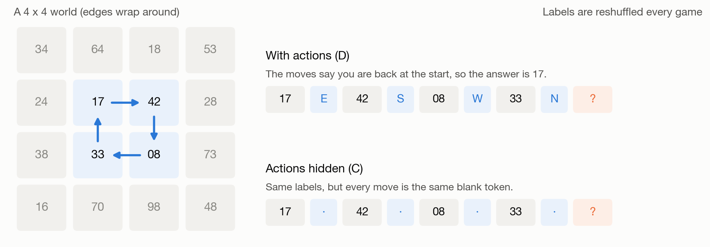
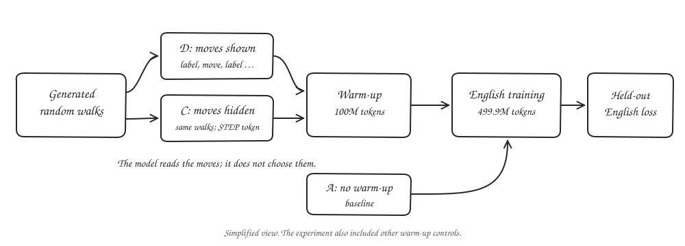
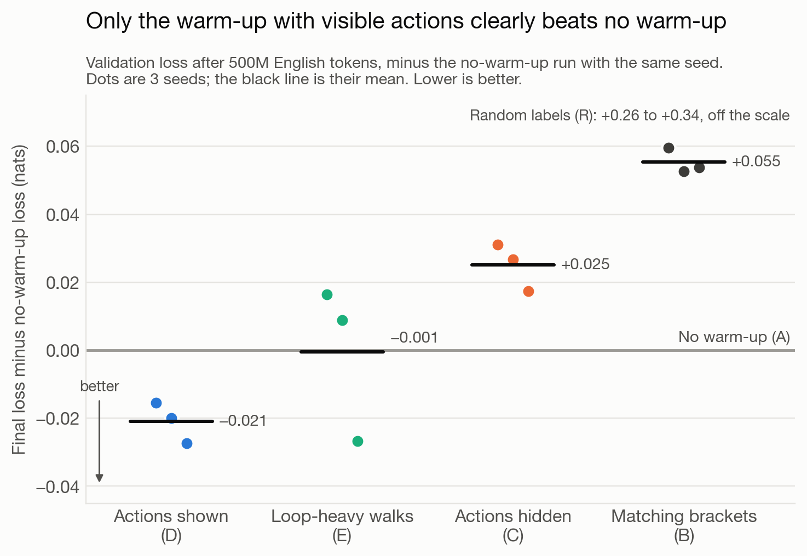
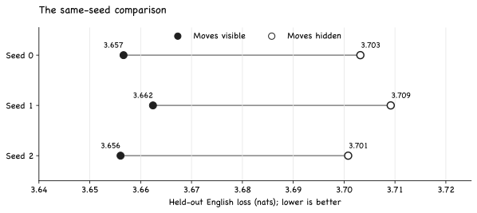
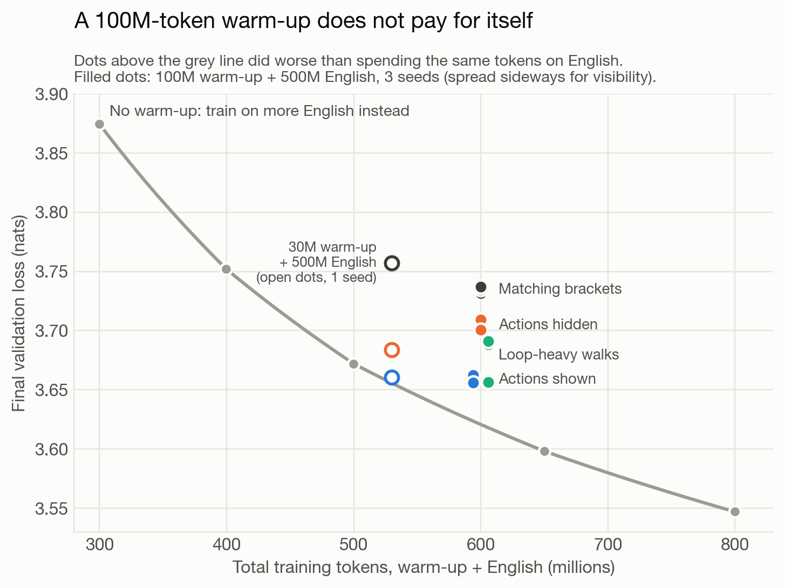
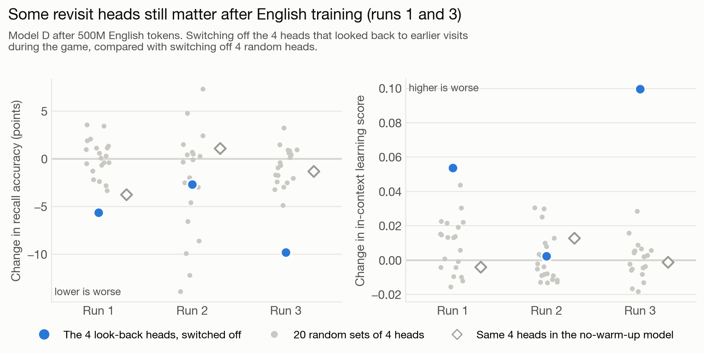

I keep thinking about what a model might learn from a record of movement. When we read, we keep track of things that change: who entered the room, where an object was left, what happened after someone did something. A language model has to deal with those relationships too. What if, before it read English, I showed it a little world where moves and their consequences were written down?

This question comes partly from how animals learn. In a classic experiment, [Held and Hein](https://pubmed.ncbi.nlm.nih.gov/14050177/) gave paired kittens similar visual experience, but only one kitten in each pair moved itself. The kittens that moved developed visually guided behaviour that their passively carried partners did not. I find that distinction compelling. Acting does not just provide more pictures. It ties a change in the world to something the learner did.

There is also a connection to memory. The hippocampal formation is involved in both spatial navigation and remembering relationships. The [Tolman–Eichenbaum Machine](https://pubmed.ncbi.nlm.nih.gov/33181068/) is one attempt to model how relational structure can carry between experiences. People navigating an abstract conceptual space can also show a [grid-like neural signal](https://pubmed.ncbi.nlm.nih.gov/27313047/). Those findings do not say that a language model learns like a brain. They do make me wonder whether practising relationships in one setting can leave something useful for another.

Other work has tried giving language models a synthetic warm-up before natural language. [Hu and colleagues](https://arxiv.org/abs/2502.19249) used matching brackets and reported that their model reached a given loss with fewer tokens. [Lee and colleagues](https://arxiv.org/abs/2603.10055) explored cellular automata and reported faster convergence. I wanted to try a different kind of structure: a sequence of places connected by moves.

The important distinction is that my model did **not** control a body or choose its actions. I generated random walks first, then trained the model on their written traces. This is a test of learning from action information, not a test of active exploration like the kitten experiment.

## The little world

*A simplified game. The actual grids range from 4 × 4 to 12 × 12, with labels drawn from 256 possibilities. Select any figure to view it at full size.*

Imagine walking around a grid whose edges wrap around. Each square has a label, and the labels change from one game to the next. A record might say: here is a label, take a step north, here is another label, take a step west, and so on.

The model is trained to predict the labels, not the moves. A label at a square it has never visited cannot be guessed from the map. A label at a square it has seen before can be remembered, but the model has to keep track of where the moves have taken it. Going north then south, for example, brings it back to the same square.

My main control keeps the same walks and labels but replaces every move with the same `STEP` token. The model still sees a sequence of observations. It no longer gets to distinguish north from south.

## What I compared

*The model reads generated traces; it does not select the moves. After a synthetic warm-up, the models receive fresh token embeddings before English training.*

I trained a 51-million-parameter language model in two stages. The optional first stage used 100 million synthetic tokens. The second used the same 499.9 million tokens of FineWeb-Edu English in every run. I reinitialised the token embeddings between stages, while carrying the transformer blocks and final normalisation forward. That makes the test about what transfers beyond the particular synthetic vocabulary.

I compared six conditions:

| Condition | Before English |
|---|---|
| A | No warm-up |
| B | Matching brackets |
| C | Grid walks with moves hidden |
| D | The same kind of walks with moves visible |
| E | Visible moves, with walks made more loop-heavy |
| R | The grid format with random labels and no predictable revisits |

Each main condition had three random seeds. I also trained the no-warm-up model on different amounts of English, from 300 million to 800 million tokens. That gives me a rough way to ask how much English alone would be needed to match a warmed-up model. I wrote down the main predictions before the runs. The 25 runs took about 18 hours on one rented GPU and cost about $46.

## The moves made a difference

*Validation loss measures prediction error on held-out English. Lower is better. Each comparison uses the same amount of English training.*

The visible-move warm-up, D, beat the no-warm-up baseline in all three runs. Its final loss was lower by about 0.021 nats on average. The hidden-move warm-up, C, went the other way: its loss was about 0.025 nats higher than the baseline on average.

The comparison I find most interesting is D against C. It asks what changes when the model gets the move information, while the underlying walks stay the same.

*Each line connects the same seed across the two conditions. The gap is 0.045–0.047 nats in these runs. The [plotted values](/images/posts/action-warmup/paired-loss.csv) are copied from my experiment's score summary.*

That is a small result, but the direction is consistent across the three pairs. It makes the action information worth looking at more closely. It does not tell us, by itself, exactly what representation the model learned.

## Did the game save training?

*The comparison counts the synthetic tokens too. The English-only yardstick comes from a single-seed training ladder.*

This is where the result gets less exciting as a practical shortcut. The visible-move model used 100 million tokens on the grid and then 499.9 million on English. From the English-only ladder, the plain model would match its final loss after roughly 517.5 million to 529.3 million English tokens. In this comparison, 100 million grid tokens bought the equivalent of only about 18 million to 29 million extra English tokens.

I also tried a 30-million-token version. It kept much of the loss improvement and landed near break-even, depending on how the comparison is made. That is one run, and the ladder itself has seed noise. I would call it a reason to test shorter warm-ups, not evidence that this one saves compute.

## What remained after English training?

During the grid warm-up, some attention heads learned to look from a revisit back to an earlier visit to the same square. I selected four strong revisit heads in each run, then switched those heads off after the model had finished learning English.

In two of the three seeds, removing these heads hurt the language probes more than any of 20 random sets of four heads. Recall of facts presented earlier in a prompt fell by 5.6 and 9.8 percentage points in those two seeds. The corresponding heads mattered less in the no-warm-up models. In the third seed, the selected heads were not clearly different from random sets.

That is the part I want to understand better. The heads identified during the game were still useful after language training in two runs. The ablation does not prove that the warm-up created every function those heads later performed, or explain how the transfer happened.

## A few results I did not expect

The loop-heavy walks, E, did better on their own grid task but generally transferred worse than the ordinary visible-move walks. Two seeds ended worse than no warm-up on English, while the third was close to D. Being good at this particular game was not the same thing as transferring well.

Matching brackets, B, was the weakest structured warm-up in this setup. That is not a direct test of Hu and colleagues' result. Their model and training pipeline differed from mine, including model size and what carried over between stages.

The random-label condition, R, did much worse on English and had much lower induction-head scores. I do not know why. The result is a useful reminder that a warm-up can change the model in ways that make later learning harder.

## Where I want to go next

I want to repeat the visible-move experiment with 10 million, 20 million, 30 million, and 50 million warm-up tokens, using multiple seeds for each. The question is whether there is a shorter region where the signal still transfers and the full training budget actually falls. If that holds, a larger model would be the next test.

I also want to look inside the sequence of learning rather than treating the final loss as the whole story. When do revisit heads appear? Which ones continue to matter? And does the model really track a changing location, or does it find a cheaper shortcut that happens to work on these grids?

## Limitations

This is one small model and one family of generated worlds. Three seeds cannot tell us how broadly the effect will hold. The English-only token ladder uses one seed, and the 30-million-token dose was tested once. The grammar probe did not clearly separate the main settings, and the in-context learning measure did not support every prediction. Finally, these are observations of models trained on traces of movement. They do not establish that acting in an environment would have the same effect.

## References

- Held and Hein. *Movement-produced stimulation in the development of visually guided behavior.* 1963. [PubMed](https://pubmed.ncbi.nlm.nih.gov/14050177/)
- Caselles-Dupré, Garcia-Ortiz and Filliat. *Symmetry-Based Disentangled Representation Learning requires Interaction with Environments.* 2019. [arXiv:1904.00243](https://arxiv.org/abs/1904.00243)
- Constantinescu, O'Reilly and Behrens. *Organizing conceptual knowledge in humans with a gridlike code.* 2016. [PubMed](https://pubmed.ncbi.nlm.nih.gov/27313047/)
- Hu, Petty, Shi, Merrill and Linzen. *Between Circuits and Chomsky: Pre-pretraining on Formal Languages Imparts Linguistic Biases.* 2025. [arXiv:2502.19249](https://arxiv.org/abs/2502.19249)
- Lee, Han, Kumar and Agrawal. *Training Language Models via Neural Cellular Automata.* 2026. [arXiv:2603.10055](https://arxiv.org/abs/2603.10055)
- Whittington and colleagues. *The Tolman-Eichenbaum Machine: Unifying Space and Relational Memory through Generalization in the Hippocampal Formation.* 2020. [PubMed](https://pubmed.ncbi.nlm.nih.gov/33181068/)
- Olsson and colleagues. *In-context Learning and Induction Heads.* 2022. [Transformer Circuits](https://transformer-circuits.pub/2022/in-context-learning-and-induction-heads/index.html)
