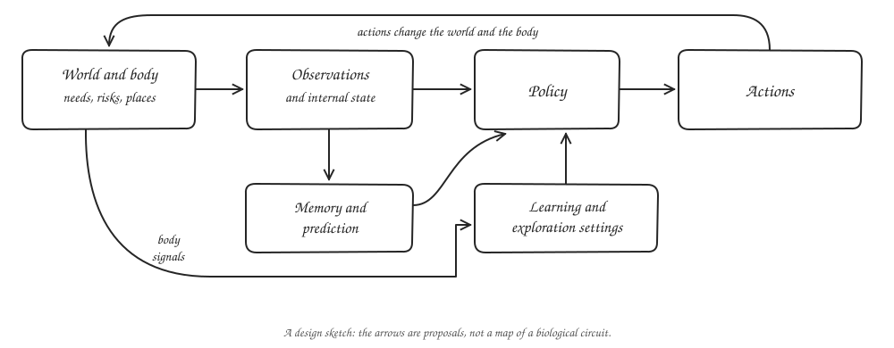
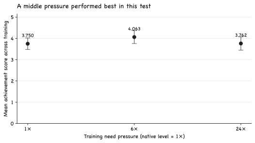
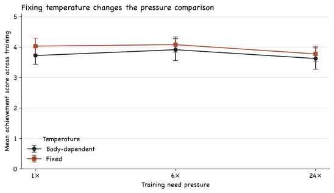
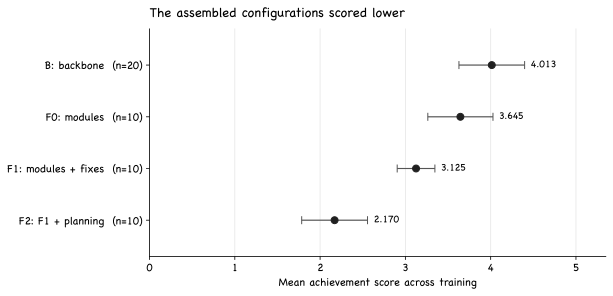

**TL;DR:** What can an agent learn when it must manage hunger, energy, and danger together? In a small survival game, changing the rate at which needs drain changed learning, but a later control showed that exploration settings could explain much of the apparent benefit at the middle pressure. An assembled agent with memory, curiosity, and planning scored below its simpler backbone. The lesson is a research programme built around measurable jobs for each component, with controls that can show when an appealing biological analogy fails.

## Why give an agent needs?

A benchmark often gives an agent a task and a score. An animal has a messier problem: it must keep itself alive while deciding which opportunities to pursue. Food, rest, and safety compete for attention, and a useful action now may make a later action possible. That makes a survival world a useful laboratory for studying how an agent allocates attention and action over time.

The appeal is not that hunger automatically produces intelligence. It gives us a concrete way to ask when internal state should change a decision. The same water source can be irrelevant when an agent is well supplied and urgent when it is thirsty. If the agent remembers the source, can it use that memory when the need changes? If it plans, can its prediction help it choose a safer route? Each question has a comparison that can fail.

This is also a question about learning efficiency. A reward that reflects the agent's condition might provide useful feedback before it discovers a difficult achievement. But a convenient signal can also send the agent toward the wrong behaviour. The experiment has to distinguish help with the original task from success at a new objective created by the signal.

## Starting with a body

Imagine an agent that finds water in a place it has visited before. Its need for water matters now. Its memory of that place matters because of the need. Its prediction of what lies between here and there might matter because the route is dangerous. I like this picture because the pieces have reasons to talk to one another.

[Keramati and Gutkin's homeostatic reinforcement learning model](https://elifesciences.org/articles/04811) formalises one version of this idea. The agent has internal needs, and a reduction in its overall deficit can be used as a learning signal. It is a model of how physiological stability and reward might interact, not a claim that every human action or meal has only one cause.

*A sketch of the direction I want to explore. It is a design proposal, not a diagram of an established biological circuit or a claim that every arrow worked in my experiments. Select any figure to view it at full size.*

A body on its own is not enough. The agent still has to decide what deserves attention, remember what happened, and choose when to act or think. Here are the pieces I find worth exploring together.

**Needs and safety.** Internal resources can drain and be replenished. The world can hurt the agent, and survival can depend on what it does.

**Signals that change learning.** I am interested in treating something like arousal as a signal that adjusts exploration, learning speed, or another measurable setting. [Doya](https://pubmed.ncbi.nlm.nih.gov/12371507/) proposed connections between neuromodulators and learning parameters. Those connections are a useful theory to draw from, not a settled one-to-one map of each chemical to a single function.

**Curiosity.** An agent may need a reason to investigate before a place becomes immediately useful. [Prediction-based curiosity](https://proceedings.mlr.press/v70/pathak17a.html) is one way to formalise this. It also raises a hard question: how do we keep surprise from becoming a goal the agent pursues at the expense of everything else?

**Memory and prediction.** Where was the water? What happened the last time a creature appeared? An organism should be able to use the past without treating every old memory as equally relevant. A learned model of the world might also let it predict the consequences of an action before taking it.

**Planning with a cost.** More thought is not automatically better. I want the agent to spend computation when it could improve a decision, and to be cautious when its predictions are unreliable.

**A childhood.** This is further ahead, but it matters to me. Many animals learn under protection before they must deal with the world alone. I would like to explore a caregiver and a gradual handover of responsibility, rather than assume that every agent has to begin with the full problem.

The difficulty is that each proposal can look sensible in isolation. Curiosity sounds useful until the agent discovers an endlessly surprising corner of the world. Planning sounds useful until the imagined future diverges from the real one. A caregiver sounds helpful until the learner becomes excellent at waiting for lunch. These are not results from my runs. They are reasons to specify what success and failure would look like before building the whole system.

## The world I tested

For the initial experiments I used [Craftax-Classic](https://proceedings.mlr.press/v235/matthews24a.html), a fast reimplementation of the survival game [Crafter](https://arxiv.org/abs/2109.06780). The agent gathers resources, crafts, eats, drinks, sleeps, and encounters threats. The runs here use symbolic observations of the environment, not pixels.

The score in the plots combines success rates across the game's achievements. It is not the percentage of episodes in which the agent completed the whole game. For each run, I averaged evaluation scores across checkpoints during one million environment steps. The points below are means across random seeds, and the whiskers show one sample standard deviation.

## Does a more demanding body help learning?

I changed how quickly needs drained during training, then evaluated the agents under the same native-pressure condition. The question was whether making the body more demanding could help the agent learn.

*Twenty seeds per training pressure. Each point is the mean of each seed's checkpoint-averaged score; whiskers show one sample standard deviation. Evaluation used native pressure in every group. The [plotted summary](/images/posts/artificial-life/need-pressure.csv) comes from my run report.*

At the native training pressure, the mean score was 3.750. At six times the pressure, it was 4.063. At twenty-four times, it was 3.762. The middle setting beat both ends in this predeclared comparison. That is interesting to me because it suggests that the strength of the body's needs can change the course of learning, even when evaluation happens under the same pressure.

But I do not want to turn this into a general law about the best amount of pressure. This is one agent and one evaluation setting. Pressure also changes several things at once, including the experiences the agent collects and, in some configurations, its exploration settings. A later experiment makes that qualification concrete.

Why might increased pressure help at all? One possibility is that faster depletion makes the consequences of neglect arrive sooner, giving the agent more frequent feedback. Another is that it changes which situations the agent encounters: shorter lives mean more resets and more time near the beginning of an episode. Neither explanation follows from the score alone. An early attempt to match lifespans did not actually match them, because agents could die before their imposed cutoff. It therefore did not settle the reset explanation.

## A control changes the story

The policy's temperature controls how sharply it favours its highest-scoring action. Lower temperature makes the policy more concentrated; it can change both exploration during training and choices during evaluation. In the original setup, temperature depended on the body's state. Increasing need pressure therefore changed more than the rate at which resources drained.

*Later control: 20 seeds per condition, evaluated at native pressure. Points are means of each seed's checkpoint-averaged score; whiskers show one sample standard deviation. Values are transcribed from the stage report, not reconstructed from per-seed files, which were unavailable locally. The fixed and body-dependent conditions also differed in evaluation temperature.*

With body-dependent temperature, the middle pressure scored 3.914, compared with 3.723 at native pressure. With temperature fixed, the corresponding scores were 4.081 and 4.032. The earlier rise therefore cannot be attributed to need pressure alone. The fixed-temperature comparison also changes temperature at evaluation, so it does not separate a change in learning from a change in action selection. Re-evaluating the same saved policies under both temperatures would address that distinction.

At the highest pressure, the fixed-temperature score was 3.775. This was below the middle-pressure score, but it does not tell us why. The report records more deaths while asleep at high pressure. That makes sleep and exposure to threats a testable lead, not an established mechanism. A useful follow-up would record when needs become critical, where the agent sleeps, and what causes death, then alter one of those conditions while keeping the rest of the task comparable.

## Why did the assembled agent perform worse?

I wanted to put memory, prediction, curiosity, and other controls into one organism. My expectation was that the combination would give the policy more useful ways to learn. It did not work out that way in the first assembled versions.

*Evaluation used native pressure. B is the backbone without the additional modules; F0 adds a bundle of modules; F1 adds five proposed fixes; F2 adds planning to F1. Points are means across seeds and whiskers show one sample standard deviation. The [plotted summary](/images/posts/artificial-life/module-scores.csv) comes from my run report.*

The backbone averaged 4.013 across 20 seeds. The first assembled configuration averaged 3.645 across 10 seeds. The version with the proposed fixes averaged 3.125, and the version with planning averaged 2.170, each across 10 seeds. These are comparisons between whole configurations. They do not tell me that any one module caused the difference.

The comparison has another wrinkle: an earlier version of the learning-rate schedule became negative when extra world-model updates were added. The reported F1 and F2 scores above use the repaired schedule. The failure of the repaired versions is still a comparison of bundles; it is not evidence that the earlier bug explains all of their deficit.

The logs give me places to investigate. In the fixed configurations, the curiosity signal was nearly constant, so its reward bonus could act more like a payment for staying alive than a useful measure of novelty. The planning version used a weak predictive model, and its score fell later in training. Other inputs and auxiliary losses changed while the policy was learning. These are observations and possible explanations, not isolated causal tests.

One earlier comparison suggests a more specific failure mode. In a separate, small five-seed-per-condition experiment, adding a world-model loss to a shared network lowered achievement scores. When the world model used its own block and its gradients no longer reached the policy trunk, the score recovered toward the no-world-model condition. The isolated model still learned to predict. That comparison supports interference from the shared training path in that configuration; it does not identify the cause of every later module failure or show that a separate world model improves performance.

The later logs point to another candidate. The mechanism that selected how many computation loops to use stayed close to its initial behaviour instead of learning a clear allocation. These observations suggest targeted interventions, but the components changed together. They do not tell us which one accounts for the lost score.

A first check would evaluate the saved assembled policy with two loops forced, matching the backbone's action-time depth. If its score recovers, variable depth during action selection is implicated; if it does not, that does not rule out damage accumulated during training. A separate retraining comparison with halting disabled would test that possibility. For curiosity, I would measure the signal on familiar and genuinely changed situations before adding its reward, then compare the same agent with and without the bonus. A signal that cannot distinguish those cases has not earned the name novelty for this task.

I found this failure useful. It is easy to look at a biological system and say that an artificial agent needs a piece for each thing we recognise. That does not tell us whether a particular implementation sends a useful signal, whether the rest of the agent can use it, or whether adding it changes the problem the agent is solving.

There is a broader lesson in the world-model comparison. A prediction can improve while the policy becomes worse. A shared network must use the same parameters to support both jobs, and their updates need not point in compatible directions. Giving the predictor a separate pathway is one way to test that interaction. It does not make prediction useless, or prove that separation is always the best design; it tells us where to look in this agent.

## What should a signal do?

Here is the design principle I am leaning toward: before adding an internal signal, ask what information it contributes or what decision it is supposed to improve. If it adjusts exploration, I should be able to measure exploration. If it gates planning, I should check whether the plan improves the action enough to justify the cost.

Rewards need particular care. Adding a curiosity bonus changes the objective the agent is trained to optimise. Sometimes that may be exactly what we want. It should not happen by accident.

There is a useful result from [Ng, Harada, and Russell](https://people.eecs.berkeley.edu/~russell/papers/icml99-shaping.pdf). Under the usual assumptions, a potential-based bonus can guide learning while preserving the optimal policy of the original task. Its form is <math xmlns="http://www.w3.org/1998/Math/MathML" aria-label="gamma times phi of the next state minus phi of the current state"><mrow><mi>γ</mi><mi>Φ</mi><mo>(</mo><msup><mi>s</mi><mo>′</mo></msup><mo>)</mo><mo>−</mo><mi>Φ</mi><mo>(</mo><mi>s</mi><mo>)</mo></mrow></math>, where <math xmlns="http://www.w3.org/1998/Math/MathML"><mi>γ</mi></math> is the discount, <math xmlns="http://www.w3.org/1998/Math/MathML"><mi>Φ</mi></math> assigns a potential to a state, and the primed state is the next one. Terminal states and the assumptions of the result still need care. Other bonuses can change the optimal policy; they do not necessarily do so in every problem.

Imagine rewarding the agent for being comfortable on every step. That may encourage it to remain safe, but it can also discourage a temporary drop in comfort needed to reach a better resource. A potential-based shaping term instead depends on the change in a chosen state potential, with discounting. Its guarantee depends on the assumptions of the theorem and on how episode endings are handled. It is a tool for designing a comparison, not a promise that learning will be faster.

This gives me a concrete experiment. I can compare a reward based on the level of a body's deficit with a carefully implemented potential-based signal, then measure what happens to achievement and survival. I do not yet know which will work better here.

## What would make the next experiment convincing?

I want to rebuild slowly enough to see what each addition does. The first comparison should use the same backbone, training budget, evaluation seeds, and reward across conditions, changing one component at a time. It should report the whole learning curve as well as its average: a module that helps early but hurts later is different from one that never helps.

Start with memory. Place a resource outside the current observation and test whether a cue seen earlier helps the agent find it after a delay. Compare against the same policy with memory disabled, and against a simple record of the last known location. Change the resource location in some trials. If the agent keeps returning to the old location, the memory is not adapting to the relevant change. This task tests retrieval and use; it does not establish that memory will improve open-ended play.

For planning, compare the model's predicted next states against a baseline that predicts no change. Then inspect decisions where planning changes the chosen action. Evaluate those actions from matched states in the real environment, including the computation spent on planning. If planning produces accurate predictions but worse actions, prediction quality alone is not enough. If it helps only on states used to tune the planner, the test needs fresh states.

The immediate pressure test is to re-evaluate the saved policies at both temperatures. That separates changes in action selection at evaluation from differences accumulated during training. A follow-up should cross training pressure with fixed and body-dependent temperature, then use the same evaluation temperatures across conditions. Earlier fixed-temperature tests at lower pressures retained a pressure effect, so temperature cannot be assumed to explain every part of the curve. A separate comparison would test the proposed body reward against the current one, while measuring both achievement and survival. Those experiments could tell me whether the idea I find appealing is actually doing useful work.

Further out, I would like to try the body and learning-control ideas in a stronger world-model agent and, eventually, in a setting with a caregiver. The point is not to copy biology piece by piece. It is to understand how needs, perception, memory, learning, and action can form a system whose parts help one another.

## Limitations

These results come from one game, symbolic observations, and a limited training budget. The pressure comparison uses one evaluation condition, so it does not establish a universal optimum. The module comparisons change bundles of mechanisms, which prevents attribution to individual pieces. An additional wiring configuration produced non-finite results in four of ten seeds; I have not treated it as a valid performance comparison. The proposed childhood, feeling-like controls, and integrated system remain research directions. None of these experiments establishes consciousness or artificial life in the biological sense.

## References

- Doya. *Metalearning and neuromodulation.* 2002. [PubMed](https://pubmed.ncbi.nlm.nih.gov/12371507/)
- Hafner. *Benchmarking the Spectrum of Agent Capabilities.* 2022. [arXiv:2109.06780](https://arxiv.org/abs/2109.06780)
- Keramati and Gutkin. *Homeostatic Reinforcement Learning for Integrating Reward Collection and Physiological Stability.* 2014. [eLife](https://elifesciences.org/articles/04811)
- Matthews and colleagues. *Craftax: A Lightning-Fast Benchmark for Open-Ended Reinforcement Learning.* 2024. [PMLR](https://proceedings.mlr.press/v235/matthews24a.html)
- Ng, Harada and Russell. *Policy Invariance under Reward Transformations: Theory and Application to Reward Shaping.* 1999. [paper](https://people.eecs.berkeley.edu/~russell/papers/icml99-shaping.pdf)
- Pathak, Agrawal, Efros and Darrell. *Curiosity-driven Exploration by Self-supervised Prediction.* 2017. [PMLR](https://proceedings.mlr.press/v70/pathak17a.html)
