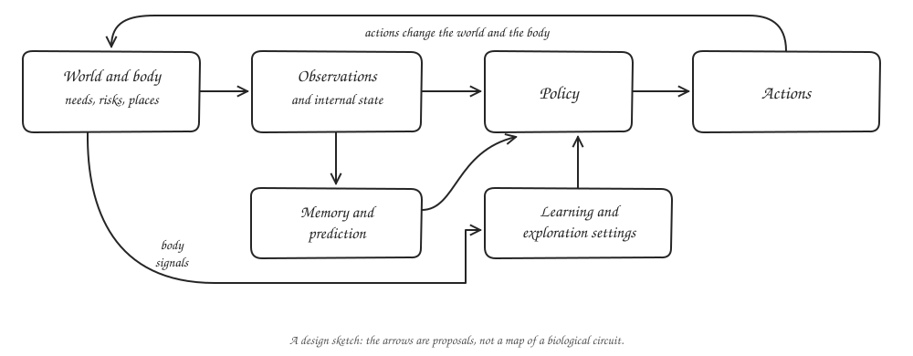
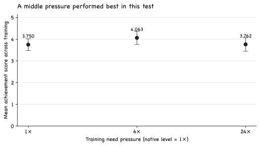
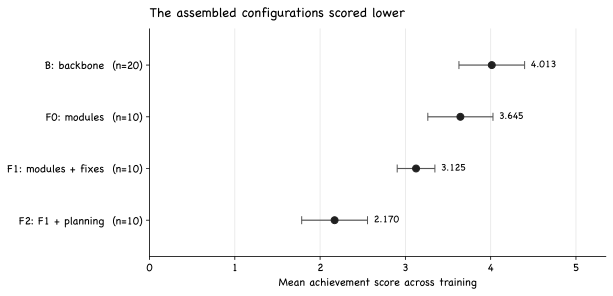

I keep coming back to a question that is bigger than the experiments in this post: what would it take for an artificial agent to develop something like a life of its own?

I want to start with something concrete. An animal has to keep a body going while it learns about a world. It gets hungry, runs out of energy, encounters danger, and has to remember where useful things are. Those pressures do not arrive as a neat list of tasks. They are there together, all the time.

I want to understand whether building from those pressures can give an agent a more coherent reason to learn. What happens when its memory, predictions, and decisions grow around the needs of a body?

## Starting with a body

Imagine an agent that finds water in a place it has visited before. Its need for water matters now. Its memory of that place matters because of the need. Its prediction of what lies between here and there might matter because the route is dangerous. I like this picture because the pieces have reasons to talk to one another.

[Keramati and Gutkin's homeostatic reinforcement learning model](https://elifesciences.org/articles/04811) formalises one version of this idea. The agent has internal needs, and a reduction in its overall deficit can be used as a learning signal. It is a model of how physiological stability and reward might interact, not a claim that every human action or meal has only one cause.

*A sketch of the direction I want to explore. It is a design proposal, not a diagram of an established biological circuit or a claim that every arrow worked in my experiments. Select any figure to view it at full size.*

A body on its own is not enough. The agent still has to decide what deserves attention, remember what happened, and choose when to act or think. Here are the pieces I find worth exploring together.

**Needs and safety.** Internal resources can drain and be replenished. The world can hurt the agent, and survival can depend on what it does.

**Signals that change learning.** I am interested in treating something like arousal as a signal that adjusts exploration, learning speed, or another measurable setting. [Doya](https://pubmed.ncbi.nlm.nih.gov/12371507/) proposed connections between neuromodulators and learning parameters. Those connections are a useful theory to draw from, not a settled one-to-one map of each chemical to a single function.

**Curiosity.** An agent may need a reason to investigate before a place becomes immediately useful. [Prediction-based curiosity](https://proceedings.mlr.press/v70/pathak17a.html) is one way to formalise this. It also raises a hard question: how do we keep surprise from becoming a goal the agent pursues at the expense of everything else?

**Memory and prediction.** Where was the water? What happened the last time a creature appeared? An organism should be able to use the past without treating every old memory as equally relevant. A learned model of the world might also let it predict the consequences of an action before taking it.

**Planning with a cost.** More thought is not automatically better. I want the agent to spend computation when it could improve a decision, and to be cautious when its predictions are unreliable.

**A childhood.** This is further ahead, but it matters to me. Many animals learn under protection before they must deal with the world alone. I would like to explore a caregiver and a gradual handover of responsibility, rather than assume that every agent has to begin with the full problem.

## The world I tested

For the initial experiments I used [Craftax-Classic](https://proceedings.mlr.press/v235/matthews24a.html), a fast reimplementation of the survival game [Crafter](https://arxiv.org/abs/2109.06780). The agent gathers resources, crafts, eats, drinks, sleeps, and encounters threats. The runs here use symbolic observations of the environment, not pixels.

The score in the plots combines success rates across the game's achievements. It is not the percentage of episodes in which the agent completed the whole game. For each run, I averaged evaluation scores across checkpoints during one million environment steps. The points below are means across random seeds, and the whiskers show one sample standard deviation.

## First, a result about need pressure

I changed how quickly needs drained during training, then evaluated the agents under the same native-pressure condition. The question was whether making the body more demanding could help the agent learn.

*Twenty seeds per training pressure. Each point is the mean of each seed's checkpoint-averaged score; whiskers show one sample standard deviation. Evaluation used native pressure in every group. The [plotted summary](/images/posts/artificial-life/need-pressure.csv) comes from my run report.*

At the native training pressure, the mean score was 3.750. At six times the pressure, it was 4.063. At twenty-four times, it was 3.762. The middle setting beat both ends in this predeclared comparison. That is interesting to me because it suggests that the strength of the body's needs can change the course of learning, even when evaluation happens under the same pressure.

But I do not want to turn this into a general law about the best amount of pressure. This is one agent and one evaluation setting. Pressure also changes several things at once, including the experiences the agent collects and, in some configurations, its exploration settings. A later temperature comparison made exploration a plausible part of the story, but it did not isolate a single cause.

## Then, the build that pushed back

I wanted to put memory, prediction, curiosity, and other controls into one organism. My expectation was that the combination would give the policy more useful ways to learn. It did not work out that way in the first assembled versions.

*Evaluation used native pressure. B is the backbone without the additional modules; F0 adds a bundle of modules; F1 adds five proposed fixes; F2 adds planning to F1. Points are means across seeds and whiskers show one sample standard deviation. The [plotted summary](/images/posts/artificial-life/module-scores.csv) comes from my run report.*

The backbone averaged 4.013 across 20 seeds. The first assembled configuration averaged 3.645 across 10 seeds. The version with the proposed fixes averaged 3.125, and the version with planning averaged 2.170, each across 10 seeds. These are comparisons between whole configurations. They do not tell me that any one module caused the difference.

The logs give me places to investigate. In the fixed configurations, the curiosity signal was nearly constant, so its reward bonus could act more like a payment for staying alive than a useful measure of novelty. The planning version used a weak predictive model, and its score fell later in training. Other inputs and auxiliary losses changed while the policy was learning. These are observations and possible explanations, not isolated causal tests.

I found this failure useful. It is easy to look at a biological system and say that an artificial agent needs a piece for each thing we recognise. That does not tell us whether a particular implementation sends a useful signal, whether the rest of the agent can use it, or whether adding it changes the problem the agent is solving.

## What should a signal do?

Here is the design principle I am leaning toward: before adding an internal signal, ask what information it contributes or what decision it is supposed to improve. If it adjusts exploration, I should be able to measure exploration. If it gates planning, I should check whether the plan improves the action enough to justify the cost.

Rewards need particular care. Adding a curiosity bonus changes the objective the agent is trained to optimise. Sometimes that may be exactly what we want. It should not happen by accident.

There is a useful result from [Ng, Harada, and Russell](https://people.eecs.berkeley.edu/~russell/papers/icml99-shaping.pdf). Under the usual assumptions, a potential-based bonus can guide learning while preserving the optimal policy of the original task. Its form is <math xmlns="http://www.w3.org/1998/Math/MathML" aria-label="gamma times phi of the next state minus phi of the current state"><mrow><mi>γ</mi><mi>Φ</mi><mo>(</mo><msup><mi>s</mi><mo>′</mo></msup><mo>)</mo><mo>−</mo><mi>Φ</mi><mo>(</mo><mi>s</mi><mo>)</mo></mrow></math>, where <math xmlns="http://www.w3.org/1998/Math/MathML"><mi>γ</mi></math> is the discount, <math xmlns="http://www.w3.org/1998/Math/MathML"><mi>Φ</mi></math> assigns a potential to a state, and the primed state is the next one. Terminal states and the assumptions of the result still need care. Other bonuses can change the optimal policy; they do not necessarily do so in every problem.

This gives me a concrete experiment. I can compare a reward based on the level of a body's deficit with a carefully implemented potential-based signal, then measure what happens to achievement and survival. I do not yet know which will work better here.

## Where I want to go next

I want to rebuild slowly enough to see what each addition does. A memory should pass a retrieval test before its output reaches the policy. A world model should earn trust against simple baselines before the agent uses its imagined futures. A planning mechanism should show that the actions it changes are better, not just that it produces a plan.

I also want to separate need pressure from exploration. One test would hold temperature fixed while varying pressure, then test a need-driven controller against that fixed setting. Another would compare the proposed body reward directly with the current one. Those experiments could tell me whether the idea I find appealing is actually doing useful work.

Further out, I would like to try the body and learning-control ideas in a stronger world-model agent and, eventually, in a setting with a caregiver. The point is not to copy biology piece by piece. It is to understand how needs, perception, memory, learning, and action can form a system whose parts help one another.

## Limitations

These results come from one game, symbolic observations, and a limited training budget. The pressure comparison uses one evaluation condition, so it does not establish a universal optimum. The module comparisons change bundles of mechanisms, which prevents attribution to individual pieces. An additional wiring configuration produced non-finite results in four of ten seeds; I have not treated it as a valid performance comparison. The proposed childhood, feeling-like controls, and integrated system remain research directions. None of these experiments establishes consciousness or artificial life in the biological sense.

## References

- Doya. *Metalearning and neuromodulation.* 2002. [PubMed](https://pubmed.ncbi.nlm.nih.gov/12371507/)
- Hafner. *Benchmarking the Spectrum of Agent Capabilities.* 2022. [arXiv:2109.06780](https://arxiv.org/abs/2109.06780)
- Keramati and Gutkin. *Homeostatic Reinforcement Learning for Integrating Reward Collection and Physiological Stability.* 2014. [eLife](https://elifesciences.org/articles/04811)
- Matthews and colleagues. *Craftax: A Lightning-Fast Benchmark for Open-Ended Reinforcement Learning.* 2024. [PMLR](https://proceedings.mlr.press/v235/matthews24a.html)
- Ng, Harada and Russell. *Policy Invariance under Reward Transformations: Theory and Application to Reward Shaping.* 1999. [paper](https://people.eecs.berkeley.edu/~russell/papers/icml99-shaping.pdf)
- Pathak, Agrawal, Efros and Darrell. *Curiosity-driven Exploration by Self-supervised Prediction.* 2017. [PMLR](https://proceedings.mlr.press/v70/pathak17a.html)
