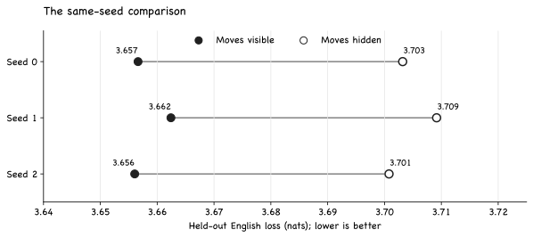
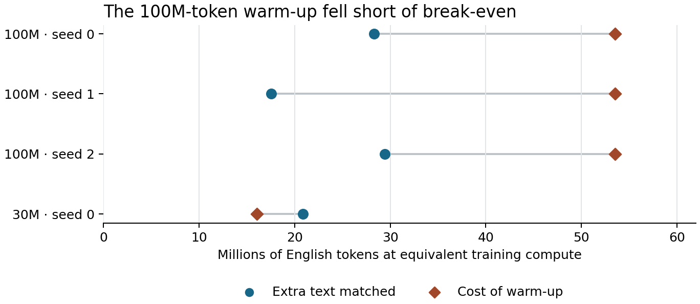
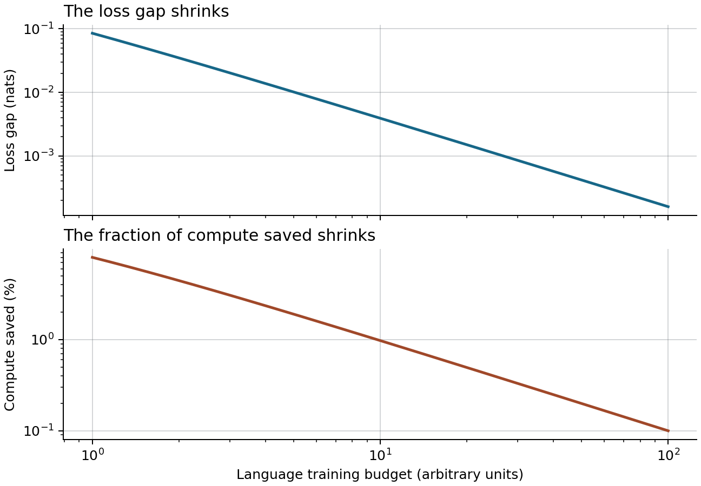
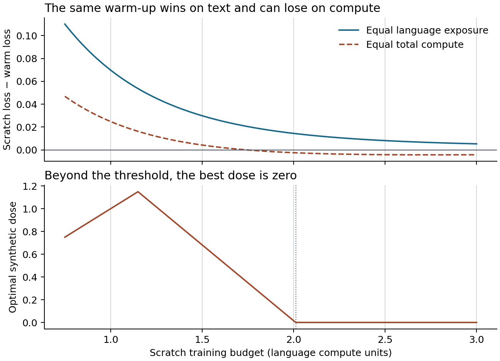

**TL;DR.** A synthetic warm-up can improve loss at every fixed text budget and still become a worse use of compute. In a model we can solve exactly, this happens when synthetic training corrects the errors that language training learns quickly, while the remaining errors respond better to text. Above a calculable budget, every positive warm-up dose loses. My grid-walk runs give a smaller empirical version of the accounting problem. The long warm-up cost about 54 million English tokens in equivalent compute and bought the loss improvement of roughly 18–29 million against the scratch ladder. Whether the same mechanism explains the real runs is a question we can test.

## Why start with synthetic data?

A walk around a grid gives a model practice tracking a location across several moves. When it returns to a square, the label it saw earlier becomes useful again. A similar dependency shows up in text when a program uses a variable declared several lines above.

Pre-pre-training puts exercises like this before ordinary language training. The bet is that a model can practise a specific operation on synthetic examples and then learn from fewer English tokens. To save compute, the warm-up also has to beat spending those same resources on more text.

## What is an NCA, and why use one?

A cellular automaton is a grid whose cells change according to local rules. A cell's next state depends on its current state and those of nearby cells. Repeat the update and local interactions can produce patterns that travel, interact, and change over time. In a *neural* cellular automaton, a neural network specifies the local update rule.

[Lee and colleagues](https://arxiv.org/html/2603.10055v2) generate sequences from many such systems, represent their states as tokens, and train a language model to predict them. The model can encounter different rules in different sequences. The appeal is that the data contain temporal and spatial dependencies without the meanings, facts, and word frequencies of English. If some training transfers to language after the model's token embeddings are replaced, something beyond a shared vocabulary must be involved.

Attention analyses in the NCA paper suggest that some structure transfers. Predicting an automaton's next state can also reward shortcuts, so those results leave open whether the model learns to infer a general transition rule.

## Does the benefit disappear with scale?

In the November 2026 revision of the NCA paper, the authors report an OpenWebText perplexity improvement over scratch of 8.6% for a 400-million-parameter model and 5.8% for a 3-billion-parameter model. On FineWeb-Edu, the reported improvement goes in the other direction: 4% at 1.6 billion parameters and 6% at 3 billion, with the language budget also scaled. The 3-billion-parameter FineWeb-Edu run retains a perplexity advantage through 98 billion language tokens. These are relative perplexity comparisons in the authors' settings, not estimates of a universal scaling law. [Source: Lee and colleagues, Figure 3 and Section 5.1.](https://arxiv.org/html/2603.10055v2)

Model size and language budget change together in the FineWeb-Edu comparison. Those runs cannot isolate the effect of parameter count.

Stern and colleagues reproduce an NCA gain with the original initialization. Changing the embedding initialization improves the scratch baseline enough to close the gap in that comparison. They did not retune the NCA dose after that change. In their compute-matched experiments, spending the budget on natural-language training yielded lower or comparable validation loss across the synthetic curricula they tested. At larger budgets they searched fewer hyperparameters, and their dose and schedule sweeps cover a limited range. [Rethinking Pre-pretraining.](https://arxiv.org/html/2610.40051v1)

## The grid-walk experiment

In my [earlier experiment](/writing/2026/10/action-warm-up-game/), a small model saw records of walks on a grid. The labels at locations changed between episodes. On a revisit, the model could benefit from remembering an earlier label and using the intervening moves to determine whether it had returned.

The walks were generated before training. The model read the traces and predicted labels.

The main comparison used a 51-million-parameter model. One condition saw the direction of each move; another saw the same kind of walks with directions hidden. After the synthetic stage, the token embeddings were reinitialized and the models trained on the same amount of English. Across three seeds, the visible-move condition had lower final English validation loss than both the hidden-move condition and the no-warm-up baseline. The visible-versus-hidden gap was about 0.045–0.047 nats.

*Each line connects one seed across conditions. Lower loss is better. The [plotted values](/images/posts/action-warmup/paired-loss.csv) come from the experiment's score summary.*

Hiding the moves also makes label prediction harder, so this comparison changes both the available spatial information and the difficulty of the warm-up.

I disabled the attention heads that most strongly attended from a revisit to an earlier visit. In two of three seeds, removing those heads after English training hurt recall and the in-context probe more than any of 20 sampled random head sets. The third seed did not separate from the random sets. This measures a contribution to probe performance after training. The effect on the original language-loss gain remains untested.

Loop-heavy walks improved the grid task and generally transferred worse than ordinary walks. Random labels hurt later language performance.

## The break-even condition

Suppose I train a scratch model and a warm-started model on the same amount of English. The warmed model gets a lower validation loss. How much extra text would the scratch model need to reach that loss? Call that amount the warm-up's **effective transfer**, measured in language tokens. Hernandez and colleagues use this idea to measure transfer from text to Python. Here it lets us price a synthetic stage in the same units as its alternative. [*Scaling Laws for Transfer*, Section 1.2.](https://arxiv.org/html/2102.01293)

Fix the model size and language training recipe. Let <math><mi>D</mi></math> be the number of language tokens, <math><mi>S</mi></math> the number of synthetic tokens, and <math><mi>κ</mi></math> the ratio of their training costs per token, synthetic over language. Write <math><msub><mi>L</mi><mn>0</mn></msub></math> for scratch validation loss and <math><msub><mi>L</mi><mi>w</mi></msub></math> for warm-started validation loss. If the scratch curve falls strictly over the relevant range and reaches the warmed loss, define the extra text <math><mi>δ</mi></math> by

<math display="block" aria-label="Scratch loss at D plus delta equals warmed loss at D and S">
  <msub><mi>L</mi><mn>0</mn></msub><mo>(</mo><mi>D</mi><mo>+</mo><mi>δ</mi><mo>)</mo>
  <mo>=</mo><msub><mi>L</mi><mi>w</mi></msub><mo>(</mo><mi>D</mi><mo>,</mo><mi>S</mi><mo>)</mo><mo>.</mo>
</math>

At that loss, scratch costs the equivalent of <math><mrow><mi>D</mi><mo>+</mo><mi>δ</mi></mrow></math> language tokens. The warmed run costs <math><mrow><mi>D</mi><mo>+</mo><mi>κ</mi><mi>S</mi></mrow></math>. Subtract the two. The warm-up wins on training compute exactly when

<math display="block" aria-label="Effective transfer delta exceeds the cost of the synthetic stage kappa S">
  <mi>δ</mi><mo>&gt;</mo><mi>κ</mi><mi>S</mi><mo>.</mo>
</math>

This also gives a **loss threshold**. With the compute spent on the warm-up, the scratch model could have processed another <math><mrow><mi>κ</mi><mi>S</mi></mrow></math> tokens. Call the observed loss gain <math><mi>G</mi><mo>=</mo><msub><mi>L</mi><mn>0</mn></msub><mo>(</mo><mi>D</mi><mo>)</mo><mo>−</mo><msub><mi>L</mi><mi>w</mi></msub><mo>(</mo><mi>D</mi><mo>,</mo><mi>S</mi><mo>)</mo></math>. The warm-up wins if that gain exceeds what the same compute would have bought on the scratch curve.

<math display="block" aria-label="The observed gain must exceed the loss gain from spending the warm-up budget on language">
  <mi>G</mi><mo>&gt;</mo>
  <msub><mi>L</mi><mn>0</mn></msub><mo>(</mo><mi>D</mi><mo>)</mo><mo>−</mo>
  <msub><mi>L</mi><mn>0</mn></msub><mo>(</mo><mi>D</mi><mo>+</mo><mi>κ</mi><mi>S</mi><mo>)</mo><mo>.</mo>
</math>

This form is useful when inversion is unstable. A flat scratch curve makes a tiny change in loss look like a large change in effective tokens. If I can run scratch at the full equivalent budget, I can compare losses there directly. If I only have a bracket of scratch runs, I have to report how I interpolated between them.

### The grid runs, with the warm-up on the bill

*The scratch reference is a single-seed ladder of independently trained runs. The cost uses the study's estimated training FLOPs, with a smaller output vocabulary during the synthetic stage. [Endpoint data](/images/posts/synthetic-pretraining/grid-endpoints.csv).*

In seed zero, the 100-million-token warm-up took the held-out loss from 3.67214 to 3.65663 at the same English budget. The scratch ladder puts the equal-compute target at 3.64351, so the warm-up would have needed about 0.0286 nats of improvement. It delivered about 0.0155. The result cleared the first comparison and fell short in the second.

Against the scratch ladder, the estimated compute penalty is about 5–7% across the three long runs. The shorter warm-up comes out about 0.9% ahead in its one run. I also recalculated the study's paired checkpoint comparison in FLOPs. It asks how much compute a warm-started model has spent when it first reaches its paired scratch run's final loss. The long warm-ups range from a 1.9% penalty to a 2.5% saving on that measure. The short run saves 3.7%.

The paired comparison uses three different loss targets and allows a partly trained model to stop before it reaches the end of its learning-rate schedule. The ladder compares run endpoints, but its scratch reference comes from just one seed. The long warm-up consistently falls short against that reference. A claim about savings across training schedules needs a stronger baseline curve and a replicated short dose.

The result also leaves room for a different objective. If unique English text is scarce, the right comparison may be another pass over the same text. If generating or procuring data is costly, the accounting should include that too. Here I am comparing training arithmetic for one model size and one loss target. Stern and colleagues actually made repeated text a baseline and found it stronger than their tested synthetic curricula under that constraint. [*Rethinking Pre-pretraining*, Section 5.](https://arxiv.org/html/2610.40051v1)

### When trying a larger dose can help

Fix a target loss and let <math><msub><mi>δ</mi><mi>∗</mi></msub><mo>(</mo><mi>S</mi><mo>)</mo></math> be the number of language tokens saved at that target by a synthetic dose of size <math><mi>S</mi></math>. The target stays fixed as I change the dose. If the benefit starts at zero and has diminishing returns, its initial slope bounds what every later dose can buy:

<math display="block" aria-label="For a concave dose response, language tokens saved at dose S are at most the initial slope times S">
  <msub><mi>δ</mi><mi>∗</mi></msub><mo>(</mo><mi>S</mi><mo>)</mo>
  <mo>≤</mo><msup><msub><mi>δ</mi><mi>∗</mi></msub><mo>′</mo></msup><mo>(</mo><msup><mn>0</mn><mo>+</mo></msup><mo>)</mo><mi>S</mi><mo>.</mo>
</math>

The inequality follows because a concave curve lies below its initial tangent. If the initial slope is at or below <math><mi>κ</mi></math>, **no positive dose can beat scratch** under these assumptions. If the initial slope is higher, a short warm-up can pay while longer ones lose. The first doses matter more for this decision than the point where the curve finally plateaus.

This is a conditional result. A computation might only emerge after a minimum amount of practice, producing a dose response that rises slowly and then steepens. The grid experiment has too few doses and seeds to establish either shape. To discriminate between them, I would add small doses around the origin and enough intermediate doses to detect an onset, measuring every arm at the same loss target.

## A shrinking loss gap can come from a permanent head start

Take the simplest model of transfer. Suppose the warm-up moves the model a fixed distance along the scratch learning curve, so the same positive <math><mi>δ</mi></math> works throughout language training. For a power-law curve with floor <math><msub><mi>L</mi><mi>∞</mi></msub></math>, scale <math><mi>A</mi></math>, and exponent <math><mi>α</mi><mo>&gt;</mo><mn>0</mn></math>, this gives

<math display="block" aria-label="Scratch loss equals a floor plus A times D to the negative alpha. Warm-started loss equals scratch loss at D plus delta.">
  <mtable columnalign="left" rowspacing="0.5em">
    <mtr><mtd>
      <msub><mi>L</mi><mn>0</mn></msub><mo>(</mo><mi>D</mi><mo>)</mo><mo>=</mo>
      <msub><mi>L</mi><mi>∞</mi></msub><mo>+</mo><mi>A</mi><msup><mi>D</mi><mrow><mo>−</mo><mi>α</mi></mrow></msup><mo>,</mo>
    </mtd></mtr>
    <mtr><mtd>
      <msub><mi>L</mi><mi>w</mi></msub><mo>(</mo><mi>D</mi><mo>,</mo><mi>S</mi><mo>)</mo><mo>=</mo>
      <msub><mi>L</mi><mn>0</mn></msub><mo>(</mo><mi>D</mi><mo>+</mo><mi>δ</mi><mo>)</mo><mo>.</mo>
    </mtd></mtr>
  </mtable>
</math>

Taking the difference and expanding in <math><mfrac><mi>δ</mi><mi>D</mi></mfrac></math> gives the following approximation once the language budget is much larger than the head start:

<math display="block" aria-label="The loss gap is approximately A alpha delta divided by D to the power alpha plus one">
  <msub><mi>L</mi><mn>0</mn></msub><mo>(</mo><mi>D</mi><mo>)</mo><mo>−</mo>
  <msub><mi>L</mi><mi>w</mi></msub><mo>(</mo><mi>D</mi><mo>,</mo><mi>S</mi><mo>)</mo>
  <mo>≈</mo><mfrac><mrow><mi>A</mi><mi>α</mi><mi>δ</mi></mrow><msup><mi>D</mi><mrow><mi>α</mi><mo>+</mo><mn>1</mn></mrow></msup></mfrac><mo>.</mo>
</math>

As the curve flattens, the same horizontal distance buys less vertical improvement. Relative perplexity improvement shrinks too, since it is one minus the exponential of the negative loss gap. This is a counterexample to interpreting a shrinking perplexity advantage as evidence of forgetting. It uses a power-law illustration of the kind used in language scaling work, with a constant shift imposed as a hypothesis. [Hoffmann and colleagues, Section 3.3.](https://arxiv.org/html/2203.15556)

The absolute compute saved in this model is equivalent to <math><mrow><mi>δ</mi><mo>−</mo><mi>κ</mi><mi>S</mi></mrow></math> language tokens. It stays constant. The **fraction** saved at matched loss is

<math display="block" aria-label="Fraction of scratch compute saved equals delta minus kappa S divided by D plus delta">
  <mfrac><mrow><mi>δ</mi><mo>−</mo><mi>κ</mi><mi>S</mi></mrow><mrow><mi>D</mi><mo>+</mo><mi>δ</mi></mrow></mfrac><mo>.</mo>
</math>

*Illustrative curves. The head start and the warm-up cost are held fixed.*

A fixed warm-up can therefore keep saving the same absolute amount of compute and still become negligible as a share of a much longer run. To keep saving a fixed percentage as the language budget grows, the effective transfer that remains after paying for the warm-up must grow with the budget. Conversely, an actual reversal, from saving compute to costing more, needs something besides the flattening in this model. The effective head start might shrink, the baseline might improve, or the training recipe might change. This argument varies language exposure at a fixed model size. It makes no prediction about how the head start changes with parameter count.

There is a practical falsification test. Estimate the horizontal shift on an early, prespecified part of the curves. Use the scratch curve and that one shift to predict the later warmed loss. If the prediction misses beyond independent training-run variation, a constant shift is inadequate for that recipe. When both curves are nearly flat, compare the predicted and observed losses directly. The uncertainty on the inverse, measured in tokens, can be large even when the uncertainty in loss is small.

## Why the advantage might shrink

The scratch model could learn the same operation later. Alternatively, the warm-started model could lose access to it. Stern and colleagues found that synthetic-task performance deteriorated after the switch to language. Interleaving preserved that performance, with no clear language-loss improvement in all settings. The synthetic-task result alone cannot establish whether a circuit was erased. [Rethinking Pre-pretraining.](https://arxiv.org/html/2610.40051v1)

The dose response also depends on the generator. In the revised NCA study, gains continued over the tested budgets with the smallest state alphabet. Larger alphabets plateaued or declined. I wrote to Seungwook Han to ask whether larger models might need larger synthetic doses. A useful comparison would vary alphabet and dose independently at each model size. [Training Language Models via Neural Cellular Automata.](https://arxiv.org/html/2603.10055v2)

Initialization remains a competing explanation. The NCA paper reports gains over first-order-statistics and mimetic initialization controls. Stern and colleagues show that a different embedding initialization can close the gap in their reproduction. The controls change different parts of the recipe.

## A model in which the warm-up helps and still loses

Suppose both tasks have the same optimal predictor and start from the same parameters. Their gradients can still correct errors at different rates. I use population gradient flow to work out how those rates affect final language loss at fixed compute. Related work studies finite-sample transfer with a shared predictor and fixed-budget allocation for estimating the difference between two ridge optima. [Wu et al., Section 2.](https://arxiv.org/abs/2208.01857) [Buna, Liu and Rebeschini, Sections 2–3.](https://arxiv.org/html/2609.16262v1)

### One predictor, two training distributions

Take a linear predictor with squared loss and a shared teacher <math><msup><mi>w</mi><mo>∗</mo></msup></math>. An input with feature vector <math><mi>x</mi></math> has label <math><msup><mi>x</mi><mo>⊤</mo></msup><msup><mi>w</mi><mo>∗</mo></msup></math>. If the current parameter error is <math><mi>ε</mi><mo>=</mo><mi>w</mi><mo>−</mo><msup><mi>w</mi><mo>∗</mo></msup></math>, the squared prediction error is <math><msup><mrow><mo>(</mo><msup><mi>x</mi><mo>⊤</mo></msup><mi>ε</mi><mo>)</mo></mrow><mn>2</mn></msup></math>. Averaging over inputs gives the two population losses:

<math display="block" aria-label="Language loss is one half the error weighted by the language second moment. Synthetic loss uses the synthetic second moment.">
  <mtable columnalign="left" rowspacing="0.5em">
    <mtr><mtd>
      <msub><mi>F</mi><mi>ℓ</mi></msub><mo>(</mo><mi>w</mi><mo>)</mo><mo>=</mo>
      <mfrac><mn>1</mn><mn>2</mn></mfrac><msup><mi>ε</mi><mo>⊤</mo></msup><msub><mi>H</mi><mi>ℓ</mi></msub><mi>ε</mi><mo>,</mo>
    </mtd></mtr>
    <mtr><mtd>
      <msub><mi>F</mi><mi>s</mi></msub><mo>(</mo><mi>w</mi><mo>)</mo><mo>=</mo>
      <mfrac><mn>1</mn><mn>2</mn></mfrac><msup><mi>ε</mi><mo>⊤</mo></msup><msub><mi>H</mi><mi>s</mi></msub><mi>ε</mi><mo>.</mo>
    </mtd></mtr>
  </mtable>
</math>

The matrices are the input second moments for language and synthetic data. Give both matrices the same orthonormal eigenvectors. You can get this setting with independent features of different variances in each corpus. A feature that varies often gets a larger weight in that corpus's loss. It also gets a stronger corrective gradient. Write <math><msub><mi>λ</mi><mi>i</mi></msub></math> for the language eigenvalue of direction <math><mi>i</mi></math> and <math><msub><mi>μ</mi><mi>i</mi></msub></math> for its synthetic counterpart. Take both to be positive.

Under gradient flow, training subtracts the gradient continuously. The language error in direction <math><mi>i</mi></math> obeys <math><msub><mover><mi>ε</mi><mo>˙</mo></mover><mi>i</mi></msub><mo>=</mo><mo>−</mo><msub><mi>λ</mi><mi>i</mi></msub><msub><mi>ε</mi><mi>i</mi></msub></math>. Its solution multiplies the starting error by <math><msup><mi>e</mi><mrow><mo>−</mo><msub><mi>λ</mi><mi>i</mi></msub><mi>t</mi></mrow></msup></math> after language training time <math><mi>t</mi></math>. Write <math><msub><mi>a</mi><mi>i</mi></msub></math> for direction <math><mi>i</mi></math>'s initial contribution to the language loss, half its language eigenvalue times its squared starting error. Squaring the error gives the factor of two in the loss exponent.

A synthetic warm-up of duration <math><mi>u</mi></math> first contracts the very same error at rate <math><msub><mi>μ</mi><mi>i</mi></msub></math>. The contractions multiply. At equal language exposure, therefore, the warmed loss in every direction is the scratch loss times <math><msup><mi>e</mi><mrow><mo>−</mo><mn>2</mn><msub><mi>μ</mi><mi>i</mi></msub><mi>u</mi></mrow></msup></math>. Every direction with initial error benefits. In particular, a shrinking aggregate gap in this system needs no loss of an acquired skill.

### Make the two runs spend the same amount

Now fix total budget <math><mi>T</mi></math> in units of language training time. Let one unit of synthetic flow cost <math><mi>κ</mi></math> units of language flow. This ratio applies to the idealized dynamics. In a Transformer experiment it must be measured for the actual recipe. Scratch gets language time <math><mi>T</mi></math>. With synthetic duration <math><mi>u</mi></math>, the warmed run gets <math><mi>T</mi><mo>−</mo><mi>κ</mi><mi>u</mi></math> of language. Multiply the two contractions and collect the terms that depend on <math><mi>u</mi></math>. Define <math><msub><mi>r</mi><mi>i</mi></msub><mo>=</mo><msub><mi>μ</mi><mi>i</mi></msub><mo>−</mo><mi>κ</mi><msub><mi>λ</mi><mi>i</mi></msub></math>. The matched-compute prediction is

<math display="block" aria-label="Warm loss at a fixed total budget is the sum of the remaining scratch loss per direction times an exponential in the synthetic rate advantage and dose.">
  <mi>L</mi><mo>(</mo><mi>T</mi><mo>,</mo><mi>u</mi><mo>)</mo><mo>=</mo>
  <munder><mo>∑</mo><mi>i</mi></munder>
  <msub><mi>a</mi><mi>i</mi></msub>
  <msup><mi>e</mi><mrow><mo>−</mo><mn>2</mn><msub><mi>λ</mi><mi>i</mi></msub><mi>T</mi></mrow></msup>
  <msup><mi>e</mi><mrow><mo>−</mo><mn>2</mn><msub><mi>r</mi><mi>i</mi></msub><mi>u</mi></mrow></msup><mo>.</mo>
</math>

The sign of <math><msub><mi>r</mi><mi>i</mi></msub></math> gives the comparison that matters. A positive synthetic learning rate can still come with a negative <math><msub><mi>r</mi><mi>i</mi></msub></math>. In that direction the synthetic stage learns something useful, but the language updates it displaces would have learned more. At fixed compute, the benefit depends on **which errors remain** and **which dataset corrects those errors faster per unit of compute**.

To see whether more synthetic data can rescue a losing run, define the remaining scratch loss in direction <math><mi>i</mi></math> at budget <math><mi>T</mi></math> as <math><msub><mi>b</mi><mi>i</mi></msub><mo>=</mo><msub><mi>a</mi><mi>i</mi></msub><msup><mi>e</mi><mrow><mo>−</mo><mn>2</mn><msub><mi>λ</mi><mi>i</mi></msub><mi>T</mi></mrow></msup></math>. Differentiate the matched-compute loss with respect to dose:

<math display="block" aria-label="The slope at zero dose is minus twice the sum of remaining scratch losses times the rate advantages. The second derivative is nonnegative.">
  <mtable columnalign="left" rowspacing="0.5em">
    <mtr><mtd>
      <msub><mi>L</mi><mi>u</mi></msub><mo>(</mo><mi>T</mi><mo>,</mo><mn>0</mn><mo>)</mo><mo>=</mo>
      <mo>−</mo><mn>2</mn><munder><mo>∑</mo><mi>i</mi></munder><msub><mi>b</mi><mi>i</mi></msub><msub><mi>r</mi><mi>i</mi></msub><mo>,</mo>
    </mtd></mtr>
    <mtr><mtd>
      <msub><mi>L</mi><mrow><mi>u</mi><mi>u</mi></mrow></msub><mo>(</mo><mi>T</mi><mo>,</mo><mi>u</mi><mo>)</mo><mo>=</mo>
      <mn>4</mn><munder><mo>∑</mo><mi>i</mi></munder>
      <msub><mi>b</mi><mi>i</mi></msub><msubsup><mi>r</mi><mi>i</mi><mn>2</mn></msubsup>
      <msup><mi>e</mi><mrow><mo>−</mo><mn>2</mn><msub><mi>r</mi><mi>i</mi></msub><mi>u</mi></mrow></msup><mo>≥</mo><mn>0</mn><mo>.</mo>
    </mtd></mtr>
  </mtable>
</math>

The loss is convex in dose. If the slope at zero is nonnegative, the loss can only stay the same or rise as we add synthetic training. **Zero is a global optimum over all feasible doses.** If the slope is negative, a small positive dose improves loss. The best interior dose is where the slope rises to zero. Otherwise the best dose is at the upper budget bound. This proves the dose result in this model. Real training could violate convexity, for example if useful transfer starts only after the model has learned a prerequisite.

### Why an optimal dose can go to zero

Take a fast language direction and a slow one. Denote them by <math><mi>f</mi></math> and <math><mi>s</mi></math>. Suppose the fast direction favours synthetic updates, so <math><msub><mi>r</mi><mi>f</mi></msub><mo>&gt;</mo><mn>0</mn></math>, while the slow direction favours language, so <math><msub><mi>r</mi><mi>s</mi></msub><mo>&lt;</mo><mn>0</mn></math>. At zero dose the sign depends on the ratio of the fast direction's benefit to the slow direction's cost. After simplification the ratio is

<math display="block" aria-label="The ratio of the fast benefit to the slow cost decays exponentially with the budget.">
  <mfrac>
    <mrow><msub><mi>a</mi><mi>f</mi></msub><msub><mi>r</mi><mi>f</mi></msub></mrow>
    <mrow><msub><mi>a</mi><mi>s</mi></msub><mo>|</mo><msub><mi>r</mi><mi>s</mi></msub><mo>|</mo></mrow>
  </mfrac>
  <msup><mi>e</mi><mrow><mo>−</mo><mn>2</mn><mo>(</mo><msub><mi>λ</mi><mi>f</mi></msub><mo>−</mo><msub><mi>λ</mi><mi>s</mi></msub><mo>)</mo><mi>T</mi></mrow></msup><mo>.</mo>
</math>

If this ratio starts above one, set it equal to one and solve for the budget. This gives

<math display="block" aria-label="The budget threshold equals the log of the initial ratio divided by twice the difference of language rates.">
  <msub><mi>T</mi><mo>∗</mo></msub><mo>=</mo>
  <mfrac>
    <mrow><mi>ln</mi><mo>(</mo>
      <mfrac>
        <mrow><msub><mi>a</mi><mi>f</mi></msub><msub><mi>r</mi><mi>f</mi></msub></mrow>
        <mrow><msub><mi>a</mi><mi>s</mi></msub><mo>|</mo><msub><mi>r</mi><mi>s</mi></msub><mo>|</mo></mrow>
      </mfrac><mo>)</mo>
    </mrow>
    <mrow><mn>2</mn><mo>(</mo><msub><mi>λ</mi><mi>f</mi></msub><mo>−</mo><msub><mi>λ</mi><mi>s</mi></msub><mo>)</mo></mrow>
  </mfrac><mo>.</mo>
</math>

Below that budget, a small dose helps. At the threshold and above it, convexity rules out a compute win at any positive dose. The location of an interior optimum follows from setting the full dose derivative to zero. The log of the ratio above is divided by <math><mn>2</mn><mo>(</mo><msub><mi>r</mi><mi>f</mi></msub><mo>−</mo><msub><mi>r</mi><mi>s</mi></msub><mo>)</mo></math>, and the result is clipped to the feasible interval from zero to <math><mi>T</mi><mo>/</mo><mi>κ</mi></math>.

*Calculated example. The upper curves use a fixed dose and share the same scratch reference. The lower curve optimizes the dose separately at each total budget. Its rising segment is capped by the available compute, which can all go to synthetic data in this shared-teacher example. All parameters are illustrative.*

Both models approach the same solution. The warm-up always helps at equal language exposure. It loses at equal compute once the errors it corrects especially cheaply have mostly disappeared. Reverse the advantage so that synthetic training corrects the slow direction more cheaply and an equal-compute benefit can persist to arbitrarily long budgets in this model. The hypothesis about which errors the warm-up improves therefore has a consequence you can look for. The equations vary budget at fixed model size. A claim about parameter scaling would require measuring how initial errors and relative rates change across sizes.

The model also gives a test of timing. With shared eigenvectors and the same optimum, any interleaving with the same total time on each dataset gives the same final error. Within a direction it only changes the order of multiplying exponentials. If replay changes final loss under matched budgets and controlled schedules, at least one assumption fails. Differing optima, interactions between directions, optimizer state, and changing features can all produce order effects. Replay alone would not tell us which caused one.

### Where the power law and the head start come from

The model also contains the constant-shift story as a special case. Suppose every synthetic rate is the same multiple <math><mi>m</mi></math> of the corresponding language rate, so <math><msub><mi>μ</mi><mi>i</mi></msub><mo>=</mo><mi>m</mi><msub><mi>λ</mi><mi>i</mi></msub></math>. An interval <math><mi>u</mi></math> of synthetic training is then exactly equivalent to <math><mi>m</mi><mi>u</mi></math> units of language training. This is true direction by direction, so it is true for the total loss. At equal compute the replacement buys a net head start of <math><mo>(</mo><mi>m</mi><mo>−</mo><mi>κ</mi><mo>)</mo><mi>u</mi></math>. The size of the loss gap can change with budget, but its sign cannot reverse. The reversal in the two-direction example comes from variation in synthetic usefulness across directions.

Here is one way this model produces the power-law curve from earlier. Replace the discrete directions with a continuum of decay rates. Give the initial loss a density proportional to <math><msup><mi>λ</mi><mrow><mi>α</mi><mo>−</mo><mn>1</mn></mrow></msup></math> near zero, with an exponential cutoff at large rates. Write <math><mi>K</mi><mo>&gt;</mo><mn>0</mn></math> for the scale of that density and <math><msub><mi>t</mi><mn>0</mn></msub><mo>&gt;</mo><mn>0</mn></math> for the cutoff parameter. The scratch loss above its floor is the sum of what remains at all rates:

<math display="block" aria-label="Scratch loss above the floor is the integral over rates of their remaining contribution.">
  <mi>F</mi><mo>(</mo><mi>T</mi><mo>)</mo><mo>=</mo>
  <mi>K</mi><msubsup><mo>∫</mo><mn>0</mn><mi>∞</mi></msubsup>
  <msup><mi>λ</mi><mrow><mi>α</mi><mo>−</mo><mn>1</mn></mrow></msup>
  <msup><mi>e</mi><mrow><mo>−</mo><mn>2</mn><mo>(</mo><mi>T</mi><mo>+</mo><msub><mi>t</mi><mn>0</mn></msub><mo>)</mo><mi>λ</mi></mrow></msup>
  <mi>d</mi><mi>λ</mi><mo>.</mo>
</math>

Substitute <math><mi>z</mi><mo>=</mo><mn>2</mn><mo>(</mo><mi>T</mi><mo>+</mo><msub><mi>t</mi><mn>0</mn></msub><mo>)</mo><mi>λ</mi></math>. The remaining integral is the gamma function <math><mi>Γ</mi><mo>(</mo><mi>α</mi><mo>)</mo></math>, independent of training time. All the time dependence is in the factor outside the integral:

<math display="block" aria-label="Scratch loss above the floor is K times gamma of alpha divided by twice the shifted budget raised to alpha.">
  <mi>F</mi><mo>(</mo><mi>T</mi><mo>)</mo><mo>=</mo>
  <mfrac>
    <mrow><mi>K</mi><mi>Γ</mi><mo>(</mo><mi>α</mi><mo>)</mo></mrow>
    <msup><mrow><mo>[</mo><mn>2</mn><mo>(</mo><mi>T</mi><mo>+</mo><msub><mi>t</mi><mn>0</mn></msub><mo>)</mo><mo>]</mo></mrow><mi>α</mi></msup>
  </mfrac><mo>.</mo>
</math>

Each error decays exponentially, while their sum decays as a power law. As training proceeds, progressively slower errors account for more of the remaining loss. Uniform acceleration shifts this curve. Selective acceleration changes which errors are left, so one shift may fail to predict the curve. The rate density is an assumption of the example. It would take separate evidence to infer anything about the spectrum of a language model from a measured learning curve.

### What survives beyond quadratic losses?

The exact dose result depends on the solvable model. A first-order comparison survives under smooth deterministic gradient flow, even when the language objective changes curvature along the trajectory and the evaluation set differs from the training set.

Let <math><msub><mi>g</mi><mi>ℓ</mi></msub></math> and <math><msub><mi>g</mi><mi>s</mi></msub></math> be the language and synthetic training gradients. Let <math><msub><mi>w</mi><mi>T</mi></msub></math> be the endpoint of language-only training. Write <math><msub><mi>J</mi><mi>T</mi></msub></math> for its Jacobian with respect to the starting weights <math><msub><mi>w</mi><mn>0</mn></msub></math>. This Jacobian transports a small change at the start into a change at the endpoint. The held-out loss is <math><mi>R</mi></math>. To compute the transport, differentiate the language gradient flow with respect to its initial condition. Starting from the identity matrix, the derivative of the Jacobian obeys

<math display="block" aria-label="The time derivative of the Jacobian is minus the language Hessian along the trajectory times the Jacobian.">
  <msub><mover><mi>J</mi><mo>˙</mo></mover><mi>t</mi></msub><mo>=</mo><mo>−</mo>
  <msup><mo>∇</mo><mn>2</mn></msup><msub><mi>F</mi><mi>ℓ</mi></msub><mo>(</mo><msub><mi>w</mi><mi>t</mi></msub><mo>)</mo>
  <msub><mi>J</mi><mi>t</mi></msub><mo>.</mo>
</math>

Replace a tiny initial interval of language with an equally costly synthetic interval. The change at the start, per unit of synthetic time, is <math><mo>−</mo><msub><mi>g</mi><mi>s</mi></msub><mo>+</mo><mi>κ</mi><msub><mi>g</mi><mi>ℓ</mi></msub></math>, with both gradients evaluated at the common start. One way to see the subtraction is to factor the scratch run into the small language interval being replaced and the shared language continuation. At dose zero, the two continuations coincide. Their common change with dose cancels when we take the difference. The remaining change comes from transporting the difference between the two early updates. Apply the chain rule and change the sign to express the gain <math><msub><mi>G</mi><mi>T</mi></msub></math> as scratch held-out loss minus warm held-out loss at the same total budget.

<math display="block" aria-label="Marginal gain at zero dose is the inner product of the transported validation gradient with the difference between the synthetic gradient and the compute-equivalent language gradient.">
  <msubsup><mi>G</mi><mi>T</mi><mo>′</mo></msubsup><mo>(</mo><mn>0</mn><mo>)</mo><mo>=</mo>
  <msup><mi>q</mi><mo>⊤</mo></msup><mo>(</mo>
  <msub><mi>g</mi><mi>s</mi></msub><mo>−</mo><mi>κ</mi><msub><mi>g</mi><mi>ℓ</mi></msub>
  <mo>)</mo><mo>,</mo>
  <mspace width="0.8em"/>
  <mi>q</mi><mo>=</mo><msubsup><mi>J</mi><mi>T</mi><mo>⊤</mo></msubsup><mo>∇</mo><mi>R</mi><mo>(</mo><msub><mi>w</mi><mi>T</mi></msub><mo>)</mo><mo>.</mo>
</math>

The gradient that matters is the gradient of the **future** validation loss with respect to the starting point. Immediate agreement between a synthetic update and a language update can be misleading. A direction that helps today can have little influence after the rest of training. For the quadratic language loss, the transport is simply multiplication by the language contraction in each direction. Substitution recovers the zero-dose slope above, with the sign reversed because the equation now measures gain.

In real pre-pre-training, switching vocabularies can reset parameters and Adam can carry or discard momentum. Training also uses discrete batches and schedules. Rather than treating the gradient formula as a Transformer prediction, we can estimate the comparison with a small fork experiment. Spend equal FLOPs on a short synthetic prefix and a language prefix, apply identical transition rules in both arms, then continue on the same text. Evaluate their held-out loss difference as continuation length grows. A standard uninterrupted language-only arm measures the cost of imposing a transition at all. A separate finite-dose experiment still has to establish whether any useful training budget is saved.

## How I would test it

Start with one model size, one NCA generator, and one text corpus. Give the scratch and warm-started runs comparable tuning budgets. Estimate the horizontal shift from early checkpoints and test whether it predicts later loss on fresh runs. To estimate compute savings, use runs whose learning-rate schedules end near the chosen loss target and include the synthetic stage in the bill. Then repeat the comparison at a second model size using some of the same text budgets.

The two-rate model predicts that a short synthetic prefix will help most on examples that scratch learns quickly and may lag on examples that scratch learns more slowly. Define the groups with an independent scratch trajectory, then test that prediction with fresh examples and independently trained pairs. Using separate runs keeps noise in the scratch scores from creating an apparent effect. Branches from the same warm-up checkpoint still share their synthetic training history.

If the loss gap survives those controls, use held-out rules and initial states to test whether each model acquires and uses the same operation. Compare behavioural performance, decoding, and targeted interventions against matched controls. A causal claim about the language-loss gain requires changing the candidate computation during training and measuring the effect on subsequent learning.

## References

- Lee, Han, Kumar and Agrawal. [*Training Language Models via Neural Cellular Automata*](https://arxiv.org/abs/2603.10055v2), 2026.
- Stern, Rocktäschel, Locatelli and Ruis. [*Rethinking Pre-pretraining*](https://arxiv.org/abs/2610.40051v1), 2026.
- Wu, Zou, Braverman, Gu and Kakade. [*The Power and Limitation of Pretraining-Finetuning for Linear Regression under Covariate Shift*](https://arxiv.org/abs/2208.01857), 2022.
- Buna, Liu and Rebeschini. [*Compute-Optimal Pretrain–Fine-tune in Ridge Gradient Descent*](https://arxiv.org/abs/2609.16262v1), 2026.
- Hu, Petty, Shi, Merrill and Linzen. [*Between Circuits and Chomsky: Pre-pretraining on Formal Languages Imparts Linguistic Biases*](https://arxiv.org/abs/2502.19249), 2025.
- Ravulapalli. [*Can a model learn language more efficiently by navigating a tiny world?*](/writing/2026/10/action-warm-up-game/), 2026.
